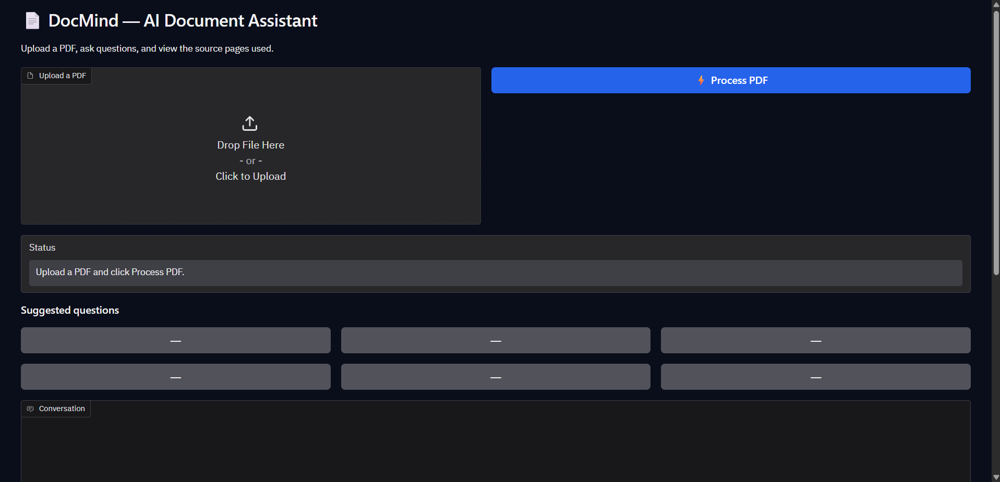
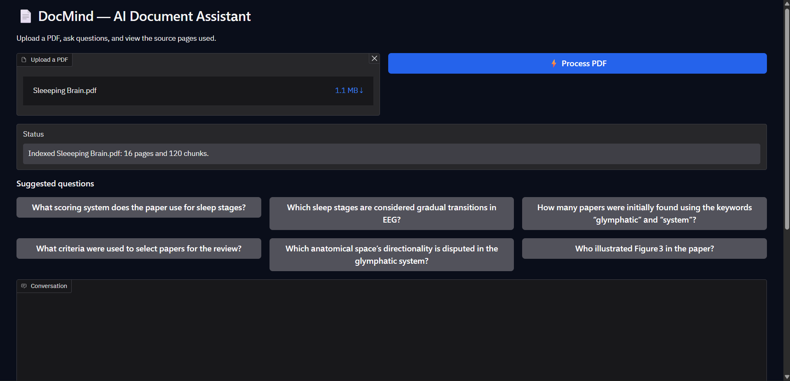
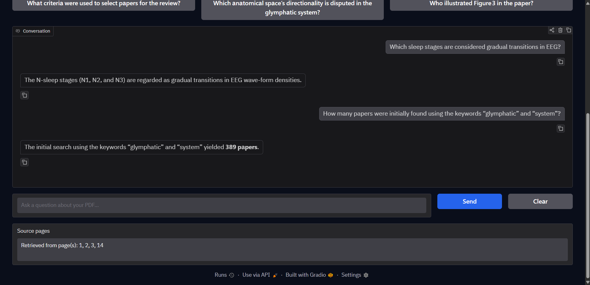

# DocMind — AI Document Assistant

An AI-powered PDF document assistant built using **Retrieval-Augmented Generation (RAG)**. Upload a PDF, ask questions in natural language, and receive context-aware answers with source references.

## Overview

DocMind allows users to interact with PDF documents through a conversational interface. Instead of manually searching through lengthy documents, users can ask questions and retrieve relevant information using an AI-powered retrieval pipeline.

## Features

* **PDF Upload:** Upload PDF documents for analysis.
* **Conversational Q&A:** Ask questions about document content using natural language.
* **Semantic Search:** Retrieve relevant document chunks using vector embeddings.
* **Source References:** Display source page information alongside answers.
* **Interactive Interface:** Chat with documents through a Gradio interface.
* **Suggested Questions:** Get started with predefined question suggestions.

## Application Screenshots

### 1. Home Interface


### 2. PDF Upload


### 3. Chat Interface


## Tech Stack

| Technology              | Purpose                              |
| ----------------------- | ------------------------------------ |
| Python                  | Core programming language            |
| LangChain               | RAG pipeline orchestration           |
| Groq                    | LLM inference                        |
| Hugging Face Embeddings | Text embedding generation            |
| FAISS                   | Vector storage and similarity search |
| Gradio                  | Interactive user interface           |
| PyPDFLoader             | PDF document loading                 |

## How It Works

DocMind follows a Retrieval-Augmented Generation workflow:

1. **Document Loading:** Extract text from uploaded PDFs using PyPDFLoader.
2. **Text Splitting:** Divide extracted text into smaller chunks using RecursiveCharacterTextSplitter.
3. **Embedding Generation:** Convert text chunks into vector representations.
4. **Vector Storage:** Store embeddings in a FAISS vector index.
5. **Retrieval:** Retrieve the most relevant chunks based on the user's query.
6. **Answer Generation:** Pass retrieved context to the language model to generate an answer.
7. **Source Attribution:** Display relevant source page references.

## Architecture

```text
       PDF Document
             |
             v
       PyPDFLoader
             |
             v
      Text Extraction
             |
             v
      Text Splitting
             |
             v
   Hugging Face Embeddings
             |
             v
        FAISS Index
             |
             v
       User Question
             |
             v
    Similarity Retrieval
             |
             v
         Groq LLM
             |
             v
    Answer + Source Pages
             |
             v
       Gradio Interface
```

## Getting Started

### 1. Clone the Repository

```bash
git clone https://github.com/harshsatyarthi-bit/DocMind.git
cd DocMind
```

### 2. Install Dependencies

Install the required Python packages used by the notebook:

```bash
pip install -r requirements.txt
```

### 3. Configure the Groq API Key

Create an API key through the Groq Console.

If running in Google Colab:

1. Open the Secrets panel.
2. Add a secret named `GROQ_API_KEY`.
3. Paste your API key as its value.
4. Enable notebook access to the secret.

**Important:** Never upload your API key to GitHub or hardcode it in the notebook.

### 4. Run the Notebook

Open `DocMind_RAG.ipynb` in Google Colab or a compatible Jupyter environment.

Run the cells in sequence, upload a PDF, and start asking questions.

## Project Structure

```text
DocMind/
│
├── DocMind_RAG.ipynb
├── README.md
└── requirements.txt
```

## Future Improvements

* Support for multiple PDF documents.
* Hybrid search combining semantic and keyword retrieval.
* Reranking for improved retrieval accuracy.
* Conversation memory.
* Retrieval and answer-quality evaluation.
* Improved document processing and error handling.

## Author

**Harsh Kumar Satyarthi**

B.Tech — ECE (IoT)

GitHub: [harshsatyarthi-bit](https://github.com/harshsatyarthi-bit)

---

If you find this project useful, consider giving the repository a ⭐.

